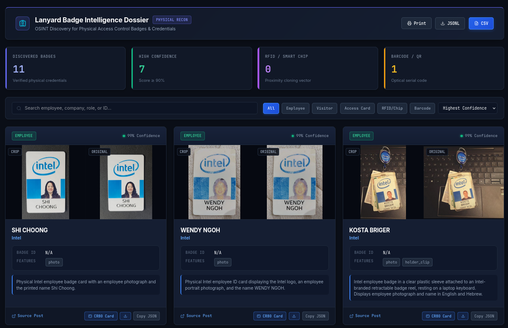
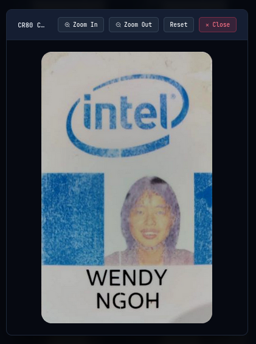
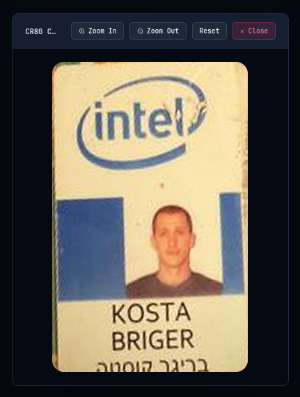

# lanyard

AI-driven badge OSINT, credential harvesting, and calibrated CR80 card cloning for physical red teams.

<p align="center">
  
</p>

## Table of Contents

- [Description](#description)
- [Prerequisites](#prerequisites)
- [Installation](#installation)
  - [Standard Installation (pip)](#standard-installation-pip)
  - [Alternative Installation (uv)](#alternative-installation-uv)
- [Configuration](#configuration)
  - [LinkedIn Authentication](#linkedin-authentication)
  - [Vision Provider Setup](#vision-provider-setup)
- [Usage](#usage)
  - [1. Company Badge Hunt](#1-company-badge-hunt)
  - [2. Local Directory Analysis](#2-local-directory-analysis)
  - [3. Interactive Dossier Server](#3-interactive-dossier-server)
  - [4. Exporting Reports](#4-exporting-reports)
- [Outputs](#outputs)
- [Supported Vision Models](#supported-vision-models)
- [License](#license)

---

## Description

During physical penetration tests and red team engagements, cloning employee access badges or creating visual counterfeits requires high-resolution references. Employees frequently upload photos of their badges on LinkedIn when starting a new job, receiving a promotion, or finishing an internship.

`lanyard` automates this collection pipeline:

1. Connects to LinkedIn via [Camoufox](https://github.com/daijro/camoufox) to bypass bot detection.
2. Searches company employee posts across multiple hiring and milestone angles.
3. Steps through multi-photo albums and carousels to catch hidden slide attachments.
4. Uses multimodal vision models to detect physical ID cards, extract cardholder details (names, roles, IDs), identify physical access markers (RFID chips, barcodes, magstripes), and locate card corners.
5. Applies a perspective homography transform to deskew the badge into flat, 300 DPI CR80 dimensions (85.6mm x 54.0mm) ready for direct PVC card printing.
6. Compiles all findings into an offline SQLite database, CSV, JSONL, and a local HTML inspection report.

---

## Prerequisites

- Linux or macOS (tested on Kali Linux and Debian/Ubuntu)
- Python 3.12+
- Standard `pip` or `uv`

---

## Installation

Lanyard works out of the box in standard Python environments using `pip`. You do not need `uv` to install or run the tool.

### Quick Setup (Automated)

Run the setup script to detect your Python environment, configure dependencies (using `uv` if present, or falling back to standard `venv` and `pip`), download [Camoufox](https://github.com/daijro/camoufox) browser binaries, and initialize local directories:

```bash
git clone https://github.com/shehzade/lanyard.git
cd lanyard
./setup.sh
```

### Manual Installation (pip)

```bash
git clone https://github.com/shehzade/lanyard.git
cd lanyard
python3 -m venv .venv
source .venv/bin/activate
pip install -e .
camoufox fetch
```

### Manual Installation (uv)

```bash
git clone https://github.com/shehzade/lanyard.git
cd lanyard
uv sync
uv run camoufox fetch
```

---

## Configuration

When working inside your activated virtual environment, execute commands directly with `lanyard <command>`. If you prefer using `uv` without manually activating the virtual environment, prefix any command with `uv run lanyard <command>`.

### LinkedIn Authentication

To search LinkedIn, provide an existing session. Two methods are supported:

**Method 1: Import `li_at` cookie (Headless)**

Copy the `li_at` cookie from your browser and import it:

```bash
lanyard cookie "AQEDAT..."
```

**Method 2: Interactive Browser Login**

Opens a browser window to log in manually. The resulting session profile is saved locally to `~/.lanyard/`:

```bash
lanyard login
```

### Vision Provider Setup

Lanyard supports Google Gemini, OpenAI, Anthropic, Ollama, and OpenRouter. You can configure credentials either by saving them to your local config (`~/.lanyard/config.json`) using `lanyard config` or by setting standard environment variables.

#### Google Gemini

```bash
lanyard config --provider gemini --gemini-key "AIzaSy..." --gemini-model "gemini-3.8-flash"
# Or: export GEMINI_API_KEY="AIzaSy..."
```

#### OpenAI

```bash
lanyard config --provider openai --openai-key "sk-..." --openai-model "gpt-4o"
# Or: export OPENAI_API_KEY="sk-..."
```

#### Anthropic

```bash
lanyard config --provider anthropic --anthropic-key "sk-ant-..." --anthropic-model "claude-3-7-sonnet-20250219"
# Or: export ANTHROPIC_API_KEY="sk-ant-..."
```

#### Ollama (Local / Air-Gapped)

```bash
ollama pull qwen2.5vl
lanyard config --provider ollama --ollama-model "qwen2.5vl" --ollama-base "http://localhost:11434"
# Or: export OLLAMA_BASE_URL="http://localhost:11434"
```

#### OpenRouter

```bash
lanyard config --provider openrouter --openrouter-key "sk-or-..." --openrouter-model "qwen/qwen-2.5-vl-72b-instruct"
# Or: export OPENROUTER_API_KEY="sk-or-..."
```

Inspect active configuration at any time:

```bash
lanyard config --show
```

---

## Usage

### 1. Company Badge Hunt

Target an organization and scrape public employee posts:

```bash
lanyard hunt -c "Acme Corp" --depth 5
```

Options:
- `-c, --company`: Target organization name.
- `-d, --depth`: Number of scroll pages to evaluate per query angle (default: 10).
- `-t, --threads`: Concurrent worker threads for vision analysis (default: 4).
- `-o, --output`: Directory to store media and database (default: `./lanyard_output`).
- `-P, --provider`: Override active vision backend (`gemini`, `openai`, `anthropic`, `ollama`, `openrouter`).
- `-m, --model`: Override model name for this scan.

Example targeting specific depth and output directory:
```bash
lanyard hunt -c "Acme Corp" --depth 12 --threads 4 -o ./acme_results
```

### 2. Local Directory Analysis

Analyze an existing directory of photos directly without opening a browser:

```bash
lanyard analyze-dir ./photos/ -o ./photos_results --threads 4
```

### 3. Interactive Dossier Server

Serve the web gallery locally:

```bash
lanyard serve -o ./acme_results -p 8088
```

Open `http://127.0.0.1:8088/report.html` in your browser. The gallery includes:
- Side-by-side view of original photos and cropped cards.
- CR80 perspective toggle for viewing the flat PVC badge layout.
- Pan and zoom controls for reading dense text, barcodes, and chip serials.
- Filter controls for badge type (employee, contractor, visitor).

#### Calibrated CR80 Card Reconstruction (300 DPI)

Lanyard detects badge boundary corners and applies a perspective homography matrix to output flat, print-ready PVC cards (85.6mm × 54.0mm):

| Shi Choong (Intel) | Wendy Ngoh (Intel) | Kosta Briger (Intel) |
| :---: | :---: | :---: |
|  |  |  |
| *Extracted: Name, Photo, Corporate Branding* | *Extracted: Name, Photo, RFID Geometry* | *Extracted: Dual-Language Typography, Badge Reel* |

### 4. Exporting Reports

Regenerate HTML, CSV, and JSONL deliverables from an existing `lanyard.db`:

```bash
lanyard report -o ./acme_results
```

---

## Outputs

All collected assets are organized inside the specified output directory:

```text
output_dir/
├── cr80/                  # Deskewed 300 DPI PVC cards (PNG and SVG)
├── crops/                 # Bounding box crops of identified badges
├── originals/             # High-resolution uncompressed downloaded photos
├── report.html            # Standalone visual report gallery
├── findings.csv           # Tabular export for spreadsheet analysis
├── findings.jsonl         # JSONL stream of structured findings and coordinates
└── lanyard.db             # SQLite database of images and detections
```

---

## Supported Vision Models

| Backend | Default Model | Notes |
| :--- | :--- | :--- |
| **Gemini** | `gemini-3.8-flash` | Fast inference, structured JSON output. |
| **OpenAI** | `gpt-4o` | Structured output via `json_schema` strict mode. |
| **Anthropic** | `claude-3-7-sonnet-20250219` | Tool-use schema enforcement. |
| **Ollama** | `qwen2.5vl` | Offline, local execution for air-gapped engagements. |
| **OpenRouter** | `qwen/qwen-2.5-vl-72b-instruct` | Cloud endpoint for open-weight models. |

---

## License

This project is licensed under the Apache License 2.0. See [LICENSE](LICENSE) for details.
